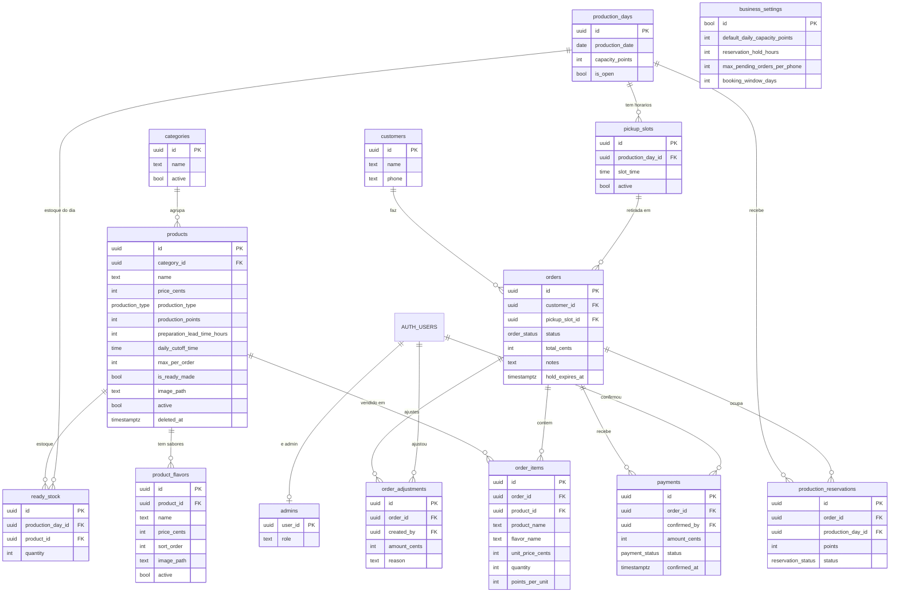

# Banco de dados - Bolos Caseiros

Escrito a partir da estrutura real do banco em 2026-11-25.
Colunas completas: veja as migrations em supabase/migrations.

## Diagrama

## Por que cada tabela existe

| Tabela                  | Para que serve                                               |
| ----------------------- | ------------------------------------------------------------ |
| categories              | Agrupa os bolos no cardapio                                  |
| products                | Cada bolo (cada tamanho e um produto). Guarda pontos e prazo |
| product_flavors         | Sabores de um bolo, cada um com o proprio preco final        |
| production_days         | Os dias de producao e a capacidade de cada um                |
| pickup_slots            | Os horarios de retirada de cada dia                          |
| ready_stock             | Estoque de pronta entrega por dia (nao gasta pontos)         |
| customers               | Nome e telefone de quem pede (um telefone = um cliente)      |
| orders                  | O pedido: quem, quando retira, total e situacao              |
| order_items             | Os itens do pedido, com "foto" do nome, sabor e preco        |
| payments                | O dinheiro que a dona confirmou (historico)                  |
| production_reservations | Os pontos que cada pedido ocupa em um dia                    |
| order_adjustments       | Ajustes de valor, sempre com motivo                          |
| admins                  | Quem pode usar o painel                                      |
| business_settings       | Regras da loja (linha unica)                                 |

## Decisoes de modelagem (os porques)

- order_items guarda o nome, o sabor e o preco NO MOMENTO da compra.
  Assim o pedido antigo continua certo mesmo se a dona mudar o produto.
- orders nao tem coluna de dia. O dia vem de pickup_slots, ligado a
  production_days. Dia e horario nunca podem se contradizer.
- Produtos, sabores e dias nao sao apagados, so desativados.
- Valores em centavos (inteiros), sem erro de arredondamento.
- Pedidos, clientes e pagamentos nao tem permissao de escrita direta:
  so mudam por funcoes, para a vaga nunca ficar presa.
- customers.email existe mas nao e usada (o cliente informa so nome
  e telefone).

## Funcoes

| Funcao                                              | O que faz                                                | Quem chama            |
| --------------------------------------------------- | -------------------------------------------------------- | --------------------- |
| create_order                                        | Cria o pedido (confere tudo; trava o dia)                | Visitante             |
| available_pickup_options                            | Dias e horarios validos para um carrinho (so uma previa) | Visitante             |
| day_capacity, day_used_points, day_available_points | Contas de pontos do dia                                  | Visitante             |
| earliest_pickup                                     | Primeiro instante de retirada possivel                   | Visitante             |
| ready_available                                     | Estoque de pronta entrega que ainda resta                | Visitante             |
| expire_pending_orders                               | Faxina: expira pedidos vencidos e libera a vaga          | Despertador (pg_cron) |
| is_admin                                            | Responde se quem chama e admin                           | Logado                |
| admin_confirm_order                                 | Confirma a entrada (50% ou outro valor)                  | Admin                 |
| admin_cancel_order                                  | Cancela/recusa e libera a vaga                           | Admin                 |
| admin_reactivate_order                              | Reativa pedido expirado/cancelado se houver vaga         | Admin                 |
| admin_complete_order                                | Conclui na retirada (registra o saldo)                   | Admin                 |
| admin_add_order_adjustment                          | Ajusta o valor com motivo                                | Admin                 |
| admin_list_orders                                   | Lista pronta para o painel                               | Admin                 |

## Storage (fotos)

Bucket publico product-images (5 MB, so jpeg/png/webp). Qualquer pessoa
ve; so admin envia, troca e apaga. O banco guarda so o CAMINHO da foto.
